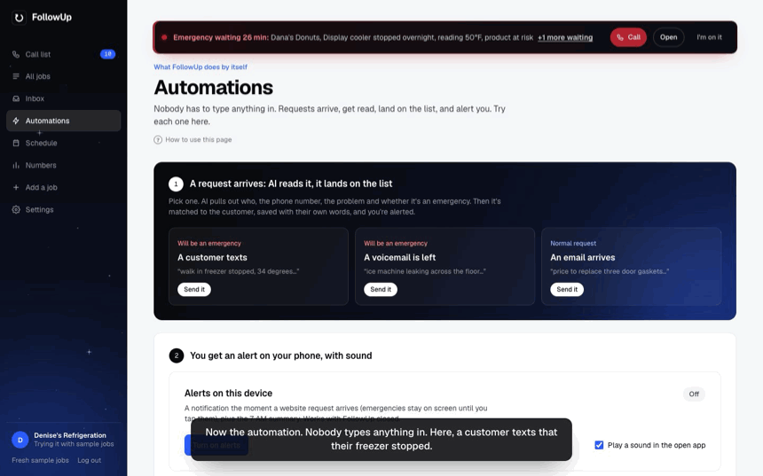
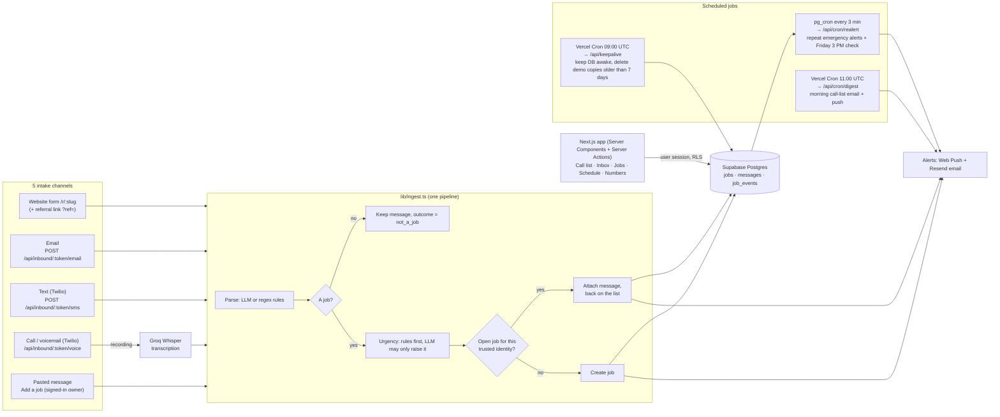
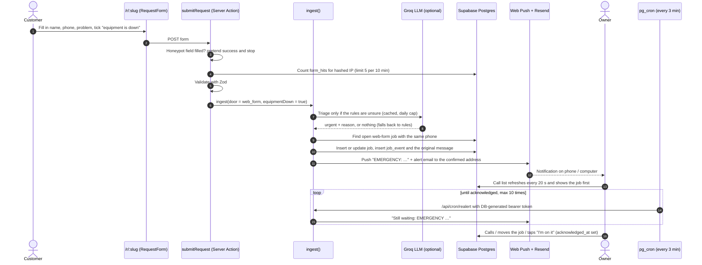
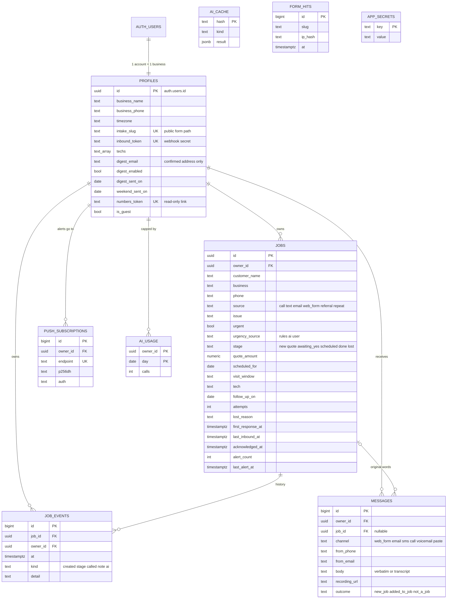

<div align="center">


# FollowUp

**A lead inbox for a small repair business: every job request from five channels lands in one pipeline, and every morning the owner gets one list of who to call and why.**

[](https://github.com/Zakuroooo/FollowUp/actions/workflows/ci.yml)


### [▶ Live demo: followup-indol-seven.vercel.app](https://followup-indol-seven.vercel.app)

Press **Try the demo** for a private copy with sample jobs. No sign-up needed.

<a href="https://followup-indol-seven.vercel.app"></a>

</div>

---

## Contents

[Problem](#the-problem) · [Features](#features) · [Screenshots](#screenshots) · [Architecture](#architecture) · [Request flow](#request-flow) · [Data model](#data-model) · [Tech stack](#tech-stack) · [Project structure](#project-structure) · [Getting started](#getting-started) · [Testing](#testing) · [Engineering decisions](#key-engineering-decisions) · [Limitations and roadmap](#limitations-and-roadmap)

---

## The problem

The user is the owner of a commercial refrigeration repair company (four technicians, 15–20 new requests a week, mostly restaurants and grocery stores). The brief came from one discovery call:

> "Some people call my cell, some fill out the form on our website, some just text me. I have a notebook too. It is a mess."
>
> "A restaurant called on a Friday, freezer down, and I forgot to follow up… by Monday they had called someone else. That is a two thousand dollar job gone."

She does not have a lead *generation* problem. She loses money in the gap between a request arriving and someone calling back, because requests are spread across several channels and nothing reminds her when one goes cold. In this trade the cost of that gap is high: a customer with a dead freezer calls the next company within hours.

FollowUp closes that gap in two parts:

1. **One pipeline.** Every channel (website form, email, text, phone call or voicemail, pasted message) goes through the same intake code and ends up as a job with the customer's original words attached.
2. **A list that can't forget.** The call list is rebuilt from plain rules every time it is loaded. A job stays on it until the owner records what happened, and emergencies keep alerting her until someone acts.

The full write-up of the discovery call and the reasoning behind the scope is in [docs/WRITEUP.md](docs/WRITEUP.md).

---

## Features

Each feature below is written as a flow through the app.

**A request comes in → it lands on the call list by itself**
- A customer fills in the public form at `/r/<code>` (with an optional "equipment is down" box), emails a forwarded inbox, texts or calls a Twilio number, or the owner pastes a message into **Add a job**.
- The message is read (by an LLM when a key is set, by regex rules otherwise) into name, phone, business, problem and urgency. Spam and invoices are kept in the inbox but are not turned into jobs.
- If the same customer already has an open job, the message is attached to it and the job comes back to the top as "They messaged you". Otherwise a new job is created.

**An emergency arrives → the owner can't miss it**
- A push notification (Web Push, works with the app closed), an in-app alarm sound, a flashing tab title and an email.
- If nobody acts, a database-scheduled job re-sends the alert every 3 minutes, at most 10 times, until she calls the customer, moves the job or presses **I'm on it**.

**Every morning → one list of who to call and why**
- The **Call list** groups open jobs into blocks in priority order: emergencies, customers who messaged again, new requests, reminders, quotes to send, quotes quiet for 2+ days, jobs ready to schedule, and visits whose date has passed.
- Each row says why the job is there and what the one next step is. **No answer** pushes it to tomorrow; after 3 unanswered tries the app suggests marking it lost (it never does so by itself).
- A 7 AM email and push notification carry the same list. On Fridays from 3 PM shop time, a "before the weekend" check lists anything that would otherwise wait until Monday.

**Working a job → stages and history**
- Stages use her own words: *New → Waiting on quote → Waiting on their yes → Scheduled → Done*, or *Lost* with a reason from a fixed list.
- The job page shows call and text buttons, the customer's original messages, a history of every change, and a drafted follow-up text (LLM-written, or from a template per stage).
- Scheduled visits get a date, an arrival window and a technician, and appear on a 14-day **Schedule**.

**Moving over from paper → notebook import**
- Paste a notebook page, one job per line, with a live preview before saving (up to 50 jobs per page).

**Reporting → Numbers**
- Open jobs, money waiting on a yes, quote win rate, median time to call back and why jobs were lost.
- A read-only link (no login, no customer names) that can be shared and switched off at any time.

**Setup → no technical screens**
- Phone alerts are turned on by scanning a QR code. The Connect page explains each channel in plain words and can email the setup steps to whoever helps her.

---

## Screenshots

> **No fresh screenshots are included in this version.** They were meant to be taken with Playwright from the live app (1440×900 desktop and 390-wide mobile) and saved to `docs/images/`. The environment used for this rewrite could not reach the live site (network policy), and the local Supabase stack could not start (its Docker images could not be pulled), so no screenshot could be taken. Mock images are deliberately not used.
>
> The animated preview at the top of this page is a recording of the real app, committed earlier in the repository's history ([`docs/preview.gif`](docs/preview.gif)). The quickest way to see every screen is the [live demo](https://followup-indol-seven.vercel.app).

---

## Architecture

Five intake channels feed one function, [`lib/ingest.ts`](lib/ingest.ts). Two kinds of scheduled job run outside any user request: Vercel Cron (daily) and Supabase `pg_cron` (every 3 minutes).



Two database clients are used, on purpose:

| Client | File | Used for |
|---|---|---|
| User client (anon key + session cookie) | [`lib/db/server.ts`](lib/db/server.ts) | Every page and action a signed-in owner triggers. Postgres RLS limits it to her own rows. |
| Service-role client | [`lib/db/admin.ts`](lib/db/admin.ts) | Webhooks, the public form and cron routes, which have no signed-in user. Each caller authenticates first (per-business token, Twilio signature, cron secret). The module imports `server-only`, so it fails the build if it is ever bundled for the browser. |

---

## Request flow

What happens when a customer submits the public website form and ticks "equipment is down":



---

## Data model

Built from the seven migrations in [`supabase/migrations`](supabase/migrations). Every table has Row-Level Security enabled.



| Table | What it holds | Row-level security |
|---|---|---|
| `profiles` | One row per account (the business): name, time zone, public form slug, webhook token, technicians, digest settings | Read/update own row only (`id = auth.uid()`). Column-level `GRANT`: users can update only `business_name`, `business_phone`, `timezone`, `digest_enabled`, `techs`. `is_guest`, tokens, `digest_email` and the "sent on" markers are server-only. |
| `jobs` | One row per customer request, with stage, quote, visit, reminder and alert state | All operations limited to `owner_id = auth.uid()`. |
| `job_events` | History of each job ("did I send the quote?") | Own rows only; inserts must also reference a job the user owns. |
| `messages` | Every original message or call transcript, from every channel | Read own rows only. Written only by the server after validation. |
| `push_subscriptions` | Browsers/phones that allowed alerts | Own rows only; `INSERT`/`UPDATE` revoked from users (added through a validated server action). A `CHECK` constraint allow-lists real push-service hosts. |
| `ai_usage` | LLM calls per business per day | Read own rows only. |
| `ai_cache` | LLM answers keyed by a SHA-256 of the input | RLS on, no policies: service role only. |
| `form_hits` | Public form submissions (hashed IP) for rate limiting | RLS on, no policies: service role only. |
| `app_secrets` | Re-alert token (generated inside the database) and URL | RLS on, no policies: service role only. |

Two `SECURITY DEFINER` triggers create the profile when a user signs up and copy the email address into `digest_email` only once it is confirmed. Demo data is loaded by `seed_demo_jobs()` (runs as the caller, so RLS still applies) and `seed_demo_extras()`.

---

## Tech stack

| Part | Tool | Why |
|---|---|---|
| Frontend | Next.js 15 (App Router, Server Components, Server Actions), React 19, Tailwind CSS v4 | Pages read data on the server and mutations are Server Actions, so there is no separate REST layer to keep in sync. Installable PWA with a service worker ([`public/sw.js`](public/sw.js)) for push. |
| Backend / API | Next.js Route Handlers on Vercel | Webhook endpoints for email/SMS/voice (`/api/inbound/[token]/…`) and cron endpoints live in the same codebase as the UI and share `lib/ingest.ts`. |
| AI | Groq API: `openai/gpt-oss-20b` (JSON mode) for parsing, triage and drafts; `whisper-large-v3-turbo` for call transcription | Fast, cheap JSON responses. Every AI call has a non-AI fallback ([`lib/ai-fallback.ts`](lib/ai-fallback.ts), [`lib/triage.ts`](lib/triage.ts)), answers are cached by hash, and each business has a daily cap (`AI_DAILY_LIMIT`, default 40). |
| Database | Supabase Postgres, `pg_cron`, `pg_net` | Row-Level Security enforces tenant isolation in the database itself. `pg_cron` + `pg_net` run the 3-minute re-alert job, because Vercel's free plan only allows daily crons. |
| Auth / security | Supabase Auth (email + password, anonymous sign-in for the demo), RLS, column-level grants, Zod, `server-only` | Zod validates every form, webhook and environment variable ([`lib/env.ts`](lib/env.ts)). Twilio webhooks are checked with HMAC-SHA1 signatures and constant-time comparison. |
| Notifications | Web Push (`web-push`, VAPID), Resend (email) | Push reaches a phone with the app closed; email carries the morning list and alerts. Both are optional and degrade to logging when keys are missing. |
| Testing | Vitest (unit), Playwright (end-to-end in Chromium) | The call-list rules are pure functions with time passed in, so they are tested without a database or a real clock. |
| CI / deploy | GitHub Actions, Vercel, Supabase CLI migrations | CI runs lint, type check, unit tests and a production build on every push to `main` and every pull request. End-to-end tests run on demand against a throwaway local Supabase. |

---

## Project structure

```
app/
  page.tsx                landing page
  app/                    signed-in app: call list, inbox, jobs, schedule, numbers, settings, "Try it" simulator
  api/inbound/[token]/    webhooks for the email, SMS and voice channels
  api/cron/               realert (every 3 min) and digest (daily) endpoints
  api/keepalive/          daily DB keep-alive and demo clean-up
  r/[slug]/               public request form
  n/[token]/              read-only Numbers link
  login, signup, forgot, reset, auth/callback   authentication pages
components/               shared UI: date picker, numbers view, alerts toggle, live refresh, …
lib/
  rules.ts                call-list rules (pure functions) + rules.test.ts
  ingest.ts               the single intake pipeline
  ai.ts, ai-fallback.ts, triage.ts, transcribe.ts   LLM calls and their non-AI fallbacks
  push.ts, email.ts, emails.ts, digest.ts           notifications
  actions/                Server Actions (jobs, intake, settings, push, auth, share, simulate)
  db/                     user-scoped and service-role Supabase clients
supabase/migrations/      schema, RLS policies, triggers, pg_cron job, demo seed functions
e2e/                      Playwright end-to-end tests
docs/                     PRD, TRD, system design, decisions log, edge cases, testing guide, write-up
scripts/                  helpers to copy environment variables into Vercel
.github/workflows/        CI (on push/PR) and on-demand end-to-end workflow
```

---

## Getting started

### Prerequisites

- Node.js 20 (the version CI uses)
- Docker, for the local Supabase stack (`npx supabase start`)

### Environment variables

Copy `.env.example` to `.env.local`. Names only; see [`.env.example`](.env.example) for comments.

| Variable | Required? |
|---|---|
| `NEXT_PUBLIC_SUPABASE_URL` | Required |
| `NEXT_PUBLIC_SUPABASE_ANON_KEY` | Required |
| `SUPABASE_SERVICE_ROLE_KEY` | Required (server only) |
| `APP_URL` | Required in production (defaults to `http://localhost:3200`) |
| `GROQ_API_KEY`, `GROQ_MODEL`, `AI_DAILY_LIMIT` | Optional: without a key, rules are used instead of AI |
| `RESEND_API_KEY`, `EMAIL_FROM` | Optional: without a key, emails are logged instead of sent |
| `CRON_SECRET` | Required for the daily digest cron in production |
| `NEXT_PUBLIC_VAPID_PUBLIC_KEY`, `VAPID_PRIVATE_KEY`, `VAPID_SUBJECT` | Optional: device push alerts |

The Twilio channels also read `TWILIO_ACCOUNT_SID` and `TWILIO_AUTH_TOKEN`, which are not yet listed in `.env.example`.

### Run locally

```bash
npm ci
npx supabase start          # local Postgres + Auth; prints the local URL and keys
cp .env.example .env.local  # paste the URL and keys
npx supabase db reset       # apply migrations
npm run dev -- -p 3200      # http://localhost:3200 → "Try the demo" loads sample jobs
```

### Checks

```bash
npm run lint        # ESLint
npm run typecheck   # tsc --noEmit
npm test            # Vitest unit tests
npm run build       # production build
npm run e2e         # Playwright; needs the app running on :3200 with a local Supabase
```

`npm ci`, `lint`, `typecheck`, `test` and `build` were run for this README and pass. The Supabase steps and `npm run e2e` could not be run in the same environment (the Supabase Docker images could not be pulled); they are the same steps the [end-to-end workflow](.github/workflows/e2e.yml) runs.

---

## Testing

| Suite | Count | Status (this rewrite) | What it covers |
|---|---|---|---|
| [`lib/rules.test.ts`](lib/rules.test.ts) | 27 tests | ✅ passing | Which block each job lands in and when it becomes overdue, priority order, reminders and "no answer → tomorrow", the 2-quiet-day follow-up, "they messaged you", the 3-tries "mark lost?" prompt, Coming up, median time to call back, rule-based parsing of a pasted voicemail, follow-up draft templates, phone helpers, the re-alert policy |
| [`lib/automation.test.ts`](lib/automation.test.ts) | 23 tests | ✅ passing | Friday check (only Fridays, Saturday–Monday window, quiet quotes), repeat alerts ("I'm on it" stops them, 3-minute spacing, max 10, 24-hour cut-off), rule-based reading and spam/invoice filtering, Twilio signature accept/reject, HTML escaping and sender-name spoofing in emails, notebook import (field order, blank lines, 50-job cap, a very long line can't slow the parser down) |
| [`e2e/demo.spec.ts`](e2e/demo.spec.ts) | 4 tests | not run here (needs local Supabase) | Guest demo flow (call list, move a job, no answer, history), jobs by stage + CSV export, signed-out visitors are redirected, and a website request arriving on the owner's call list as an emergency |

Unit test run (Vitest 3.2.7): **2 files, 50 tests, all passing**.

A step-by-step guide to checking each automation by hand (including the parts that need real email or a phone number) is in [docs/TESTING.md](docs/TESTING.md).

---

## Key engineering decisions

| Decision | Why |
|---|---|
| **Rules decide the call list, not AI.** | [`lib/rules.ts`](lib/rules.ts) is pure functions with time passed in. The owner can always see *why* someone is on her list, and the behaviour is fully unit-tested. AI is used only for messy text: parsing, borderline triage, drafts, transcription. |
| **AI can only raise urgency, never lower it.** | A missed emergency costs a job; a false alarm costs one phone call. Rules run first, and the LLM is asked only when the rules are unsure. |
| **One intake pipeline for every channel.** | Adding a channel means writing an adapter that calls `ingest()`. Duplicate detection, urgency, storage of the original message and alerts behave the same everywhere. |
| **Match customers only on identities that can be trusted.** | Caller ID (from Twilio) can match any open job. A phone number typed into the public form only matches jobs that also came from the form, and an email sender only matches jobs earlier emails from that address created. Unverified channels can bring a job back to the list but cannot change its urgency or the owner's reminder date. |

### Challenges → fixes

| Challenge | Fix |
|---|---|
| Vercel's free plan only runs crons once a day, but emergency alerts must repeat every 3 minutes. | Supabase `pg_cron` + `pg_net` call `/api/cron/realert` every 3 minutes. The bearer token is generated inside the database (`gen_random_bytes`) and stored in `app_secrets`, so it is never committed. |
| Overlapping cron runs or a manual send could email the morning list twice. | Each send first "claims" the day with one conditional `UPDATE … WHERE digest_sent_on IS DISTINCT FROM today`; only the run that wins sends. The claim is released if both email and push fail. The Friday check uses the same pattern. |
| The guest demo could have been used to send email to arbitrary addresses. | Email goes only to `digest_email`, which a trigger fills from the account's *confirmed* address. Users have no `UPDATE` grant on that column, and guest accounts never send email. |
| Storing push endpoints supplied by the browser could be abused to make the server call internal URLs (SSRF). | A `CHECK` constraint and the server action both allow-list known push-service hosts. Twilio recordings are only downloaded from `api.twilio.com`. |
| Free Supabase projects pause after a week without traffic, which would break the live demo. | A daily Vercel Cron hits `/api/keepalive`, which also deletes guest demo accounts older than 7 days. |
| A very long pasted line could slow the notebook importer's regular expressions. | Line length is capped and separators are trimmed with linear-time code instead of a backtracking regex; a unit test covers it. |
| A missing environment variable used to surface as a confusing error deep inside Supabase. | [`lib/env.ts`](lib/env.ts) validates all settings with Zod once and names the missing key. |

The full decisions log, with the rejected alternatives, is in [docs/DECISIONS.md](docs/DECISIONS.md).

---

## Limitations and roadmap

### Limitations

- **Phone and SMS channels are built but not live.** They need a Twilio number and credentials. Until `TWILIO_AUTH_TOKEN` is set, signature checking is skipped and the secret token in the webhook URL is the only gate. In the demo, these channels are exercised through the in-app simulator.
- **The email channel needs inbox forwarding** to be set up by the business; it is not connected in the live deployment.
- **Email from the live deployment uses Resend's test sender** (`onboarding@resend.dev`) until a domain is verified.
- **The morning digest runs at a fixed 11:00 UTC** (7 AM US Eastern in summer, 6 AM in winter), not at 7 AM in each business's own time zone.
- **The re-alert URL is set in a migration** to the production domain, so a fork must update `app_secrets.realert_url` after deploying.
- **One login per business.** There are no separate owner / office / technician accounts or per-user audit trail yet.
- **End-to-end tests are not part of the push/PR CI**; they run on demand.
- **No license file**, so the code is not licensed for reuse.

### Roadmap

1. Connect a Twilio number and add the Twilio variables to `.env.example`.
2. Forward the business inbox to the email channel.
3. Send the morning digest at 7 AM local time for each business.
4. Per-person logins (owner, office, technician) with an audit trail.
5. A technician view: each tech sees their day and marks jobs done, which clears "visit date passed" automatically.
6. Run the end-to-end suite on every pull request.

Deliberately out of scope: full dispatch and route planning, sending quotes or invoices, and automatic texting of customers (the app drafts, the owner sends).

---

<div align="center"><sub>Built by Pranay Sarkar · Next.js · Supabase · Vercel</sub></div>
